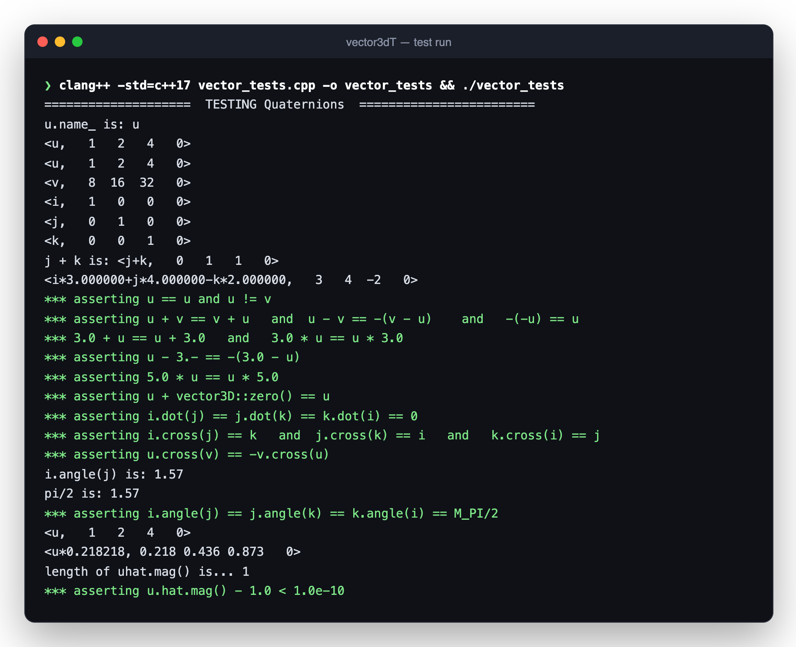

<div align="center">

# vec · mat · quat

**The 3D math behind every graphics engine (vectors, matrices and quaternions) written from scratch as header-only C++ templates, with tests baked in.**




</div>

---

## Why build it yourself?

Game engines and ray tracers lean on a handful of math types. Writing them by hand is the fastest way to really understand dot and cross products, matrix algebra, and why quaternions beat Euler angles for rotation. Each type here is a template (`float` or `double`), names its own instances for readable debug output, and ships with a `run_tests()` that asserts the algebraic laws it should obey.

## What's inside

| Header | Type | Highlights | Status |
|---|---|---|---|
| `vector3dT.h` | `vector3d<T>` | `+ − * /` with scalars and vectors, `dot`, `cross`, `angle`, `mag`/`norm`, unit vectors via `u / u.mag()`, `zero()`, i/j/k basis | ✅ Working; all of its assertions pass |
| `matrix3dT.h` | `matrix3d<T>` | Row/element indexing, compound operators, matrix–vector products, transpose, determinant, inverse | 🚧 In progress; some operators are still `TODO` |
| `quaternion_T.h` | `quaternion<T>` | Hamilton product, conjugate, inverse, norm, `rot_matrix()`, rotate a point about an axis by θ | 🚧 Written; depends on the unfinished matrix operators |

## Quick look

```cpp
#include "vector3dT.h"

vector3D u("u", 3, {1, 2, 4});
vector3D v = 8.0 * u;                      // <8, 16, 32>
auto i = vector3D("i", 3, {1, 0, 0}),
     j = vector3D("j", 3, {0, 1, 0});

i.cross(j);        // → k
i.angle(j);        // → π/2
(u / u.mag()).mag();   // → 1.0  (unit vector)
```

## Run the tests

```sh
# vector3d (passes today)
printf '#include "vector3dT.h"\nint main(){ vector3d<double>::run_tests(); }' > vector_tests.cpp
clang++ -std=c++17 vector_tests.cpp -o vector_tests && ./vector_tests

# full suite (vectors + matrices + quaternions) once matrix3d is finished
clang++ -std=c++17 main-1.cpp -o vector_matrix && ./vector_matrix
```

## About

Written by **Roszhan Raj** for CSUF computer graphics coursework.
